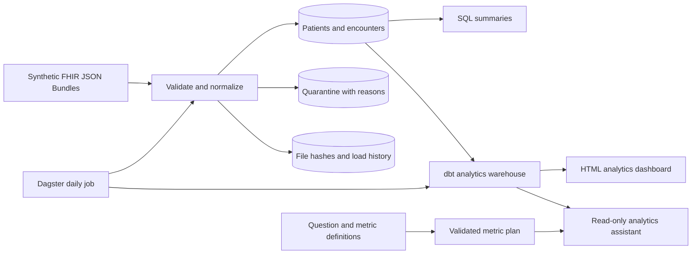

# Careflow

A healthcare data engineering portfolio, starting with a working synthetic FHIR ingestion pipeline and growing toward an AI analytics platform.

**Security review:** see the [October 2026 audit](docs/security-audit.md) for verified fixes, test evidence, and deployment limitations. Run `bash scripts/security_check.sh` after installation for dependency advisories and tracked-file secret checks.

**Separate portfolio website:** [export aggregate JSON](docs/public-dashboard.md) for `elitay152/careflow-dashboard`. Pipeline logic and metric definitions stay in Careflow; the frontend needs no database or model credentials.

**Run independently of Codex:** see [GitHub, Codespaces, and local setup](docs/github.md). `bash scripts/bootstrap.sh` prepares the full local demo. The optional manual GitHub Actions live test uses a GitHub repository secret and makes one model request; it does not use Codex's secret editor or require publishing this environment.

**Implemented:** Python ingestion, PostgreSQL / SQLite storage, record validation, quarantine, load checkpoints, duplicate-safe reruns, a dbt analytics warehouse, Dagster orchestration, an HTML dashboard, and a browser/API analytics assistant with a structured LLM planner adapter. Baseline mode and database boundaries are verified; live model evaluation awaits credentials.



## Run in five commands

Requires Python 3.11+. No services or API keys are needed for the SQLite demo.

```bash
python -m venv .venv
.venv/bin/python -m pip install -c security-constraints.txt -e '.[dev]'
.venv/bin/careflow generate-demo
.venv/bin/careflow ingest data/demo
.venv/bin/careflow report
```

Run these from the repository root. In a fresh database, expected counts: **3 patients, 3 encounters, 0 conditions, 0 medications, 1 load, 1 quarantined record**. The demo intentionally includes an invalid birth date. Ingest the same directory again: it reports `skipped` and counts remain unchanged. The report also groups encounters by administrative gender as a simple SQL demonstration, not a clinical conclusion.

## PostgreSQL

Requires Docker with Compose. Copy `.env.example` to `.env`, choose a local password, and update both values to match. URL-encode special characters in the connection URL. Never commit `.env`.

```bash
docker compose --env-file .env up -d --wait
set -a
. ./.env
set +a
.venv/bin/careflow generate-demo
.venv/bin/careflow ingest data/demo
.venv/bin/careflow report
```

`DATABASE_URL` selects PostgreSQL; without it the CLI uses `sqlite:///careflow.db`. PostgreSQL binds to the loopback interface. `docker compose down` stops it and retains its data volume. These instructions target local development.

## Analytics warehouse and dashboard

With `.env` configured as above:

```bash
bash scripts/install.sh
docker compose --env-file .env up -d --wait
.venv/bin/careflow generate-demo --extended
bash scripts/run_pipeline.sh
```

The job ingests JSON Bundles, runs `dbt build` (10 models and 32 quality checks), and writes **`data/dashboard.html`**. Open that file in a browser to view monthly utilization, recorded condition prevalence, and medication request counts. The dashboard is a static export; rerun the pipeline to refresh it.

On a fresh extended demo, there are 3 patients, 3 encounters, 3 conditions, 3 medication requests, and one quarantined record. If the original demo was also loaded, resource counts stay the same but there are two load checkpoints and two quarantine entries, one per distinct source file.

For individual steps, export `.env` as in the PostgreSQL instructions, then run:

```bash
.venv/bin/careflow ingest data/demo
.venv/bin/careflow warehouse-build
.venv/bin/careflow dashboard
```

The warehouse requires PostgreSQL. Models live in the `analytics` schema; validated input tables remain in `public`. Staging views cast dates and timestamps; dimension and fact tables preserve resource grain; aggregate marts avoid many-to-many joins. This version rebuilds tables completely; incremental warehouse processing is a later optimization.

## Scheduled execution

```bash
bash scripts/start.sh
```

This starts the local Dagster webserver and daemon, using persistent state under ignored `.dagster/`. The `daily_pipeline` asset job contains ingestion → dbt build/tests → dashboard. Enable `daily_schedule` in Dagster to run it at **06:00 UTC daily**; it starts disabled. Set `CAREFLOW_INPUT_DIR` to a directory of synthetic JSON Bundles to replace the demo input. Generate the demo before the first run.

The supplied instance configuration queues one run at a time. Avoid running the direct `run_pipeline.sh` command concurrently with daemon-scheduled loads: direct CLI execution bypasses that queue. The daemon must remain running for schedules to execute. Stopping processes does not remove PostgreSQL data or Dagster history.

## Load other synthetic data

```bash
.venv/bin/careflow ingest /path/to/synthetic/fhir
```

Accepts an individual JSON Bundle or a directory of top-level `*.json` files. Supports a **subset of FHIR R4**, not complete FHIR conformance:

- Patient: `id`, full `birthDate`, administrative `gender`.
- Encounter: `id`, `status`, `subject.reference`, and timezone-qualified `period.start` / optional `period.end`.
- Condition: patient subject, first `code.coding` system/code/display, optional `clinicalStatus`, `verificationStatus`, and `onsetDateTime`.
- MedicationRequest: patient subject, `status`, medication coding, and optional `authoredOn`. Supports inline `medicationCodeableConcept` and `medicationReference` pointing to a Medication in the same Bundle (`fullUrl` or `Medication/id`), independent of entry order. Unresolved references are quarantined; ambiguous references reject the file. Cross-Bundle and contained Medication references are not supported yet.

Clinical dates accept a full date or timezone-qualified timestamp; partial dates are quarantined. Relative `Patient/id` and Bundle Patient `fullUrl` references are supported, including Synthea-style UUID references. Other resource types are counted as ignored; Medication resources can supply lookup codes without becoming standalone warehouse rows. The built-in fixture is authored fictional data, **not Synthea output**. A larger Synthea 3.3.0 export has now been validated; see [the measured results](docs/validation.md).

## Reliability and design choices

- SHA-256 content hashes identify already-loaded files, independent of filename. A checkpoint and all changes for one file commit in one transaction; database failures roll back the entire file.
- Resource IDs are primary keys. New files update existing resources through upserts. Accepted counts describe input records processed, not newly inserted rows.
- Patients load before encounters within a Bundle. Missing patient references are quarantined; database foreign keys enforce referential integrity.
- Invalid supported records retain their raw JSON and reason in `quarantine`. Invalid JSON / invalid Bundle envelopes fail the file without a checkpoint. Unsupported resource types are counted separately.
- Each normalized row records its most recent source file hash; `loads` records source paths, timestamps, and outcomes. Raw source files remain the replay source.
- Files are processed serially in filename order; later records win. There is no FHIR version ordering, deletion handling, full change history, or concurrent-loader coordination yet. Cross-file parents must load before dependent records. To replay a quarantined record, correct the source into a new file; unchanged files remain skipped.
- After an ingestion upgrade, `careflow ingest data/demo --reprocess` explicitly replays unchanged files. This updates their checkpoints and upserts records/quarantine in one transaction. Checkpoints describe the latest processing of each file, not an append-only execution history; Dagster retains job execution history separately.

Use only synthetic data in this portfolio. Quarantine contains input payloads and source paths: this is not configured for real patient data or production deployment.

## Tests

```bash
bash scripts/install.sh
.venv/bin/pytest -q
# Optional: run the same tests against an available PostgreSQL database.
TEST_DATABASE_URL="$DATABASE_URL" .venv/bin/pytest -q
```

PostgreSQL tests create and remove uniquely named schemas; the test account needs schema-creation permission. Install the analytics extra for the PostgreSQL dbt integration test. Tests cover reruns, explicit reprocessing, resource updates, UUID references, missing parents, malformed clinical records, timezone validation, unsupported resources, cross-file references, and transaction rollback / recovery. The warehouse integration test checks distinct-patient prevalence, exclusion of refuted diagnoses and cancelled encounters, UTC month boundaries, and dashboard output. SQLite skips that PostgreSQL-only test. GitHub Actions is configured to run both database backends and the complete Dagster job when pushed.

Metric definitions, assumptions, and useful interview discussion points are in [the metric catalog](docs/metrics.md).

## Larger Synthea validation

Requires Java 17+ (validated on Java 21), the analytics extra, and running PostgreSQL. These commands keep input files and validation output under ignored `data/` and create fresh database schemas, leaving the demo untouched:

```bash
bash scripts/generate_synthea.sh
bash scripts/validate_synthea.sh
```

Generation pins Synthea 3.3.0, seed 42, clinician seed 42, 100 requested living patients, two threads, and a January 1, 2025 simulation date. Synthea also emits deceased patient histories: the measured run contains 108 patients and 110 JSON Bundles. The generator refuses to overwrite an existing output directory. Reuse its output for subsequent validation; choose a new directory argument to generate again.

The validator reads `.env`, reconciles supported IDs, patient links, selected stored values, medication codes, and input accounting; checks quarantines and orphans; verifies unchanged reruns; builds/tests dbt; independently recalculates warehouse metrics from source; and exports a dashboard. Results, input checksums, and current-run dbt artifacts are saved to `data/validation/<schema>/`. Existing database schemas and output directories are refused, never reset. A failed assertion produces a nonzero exit status and failed results; command/runtime errors also fail the run.

For an explicit fresh run name:

```bash
bash scripts/validate_synthea.sh data/synthea-v3.3.0-seed42/fhir synthea_my_validation
```

The 175 MiB generator and approximately 341 MiB source dataset are not committed. PostgreSQL retains validation schemas for inspection. Remove only named validation schemas you no longer need; the scripts never clean user data automatically. This is subset compatibility testing and a local timing measurement, not full FHIR conformance or a production load test.

## Analytics assistant

The [assistant guide](docs/assistant.md) covers its browser interface, API, read-only database role, model setup, and evaluation.

After building the extended demo warehouse, load `.env`, run `.venv/bin/python scripts/configure_assistant.py`, and start it with `bash scripts/start_assistant.sh`. It defaults to an explicitly labeled baseline mode. Questions return data, metric definitions, caveats, and parameterized query evidence.

The optional LLM planner uses `CAREFLOW_LLM_API_KEY` supplied securely through environment settings and `CAREFLOW_ASSISTANT_MODE=llm`. It chooses a validated metric/filter plan; fixed templates execute the SQL. Live model behavior is not yet verified. The baseline passes all 24 core evaluation cases and declines six broader paraphrases in the full 30-case set.

Live requests are guarded by a persistent ledger: at most **5 attempts per UTC day and 25 over the ledger's lifetime**, conservative token budgets, a fixed model allowlist, and a 256-token output cap. Failed attempts keep their reservation. Baseline remains the free default. Inspect usage with `.venv/bin/careflow usage`; follow [the low-cost API setup guide](docs/api-costs.md) before adding a key.

## Portfolio roadmap

1. **Ingestion foundation — implemented:** reproducible demo, clean relational tables, quarantine, provenance, and reliability tests.
2. **Analytics warehouse — implemented and validated:** conditions and medication requests, dbt staging/dimensional models, Dagster jobs and a configurable schedule, data quality checks, and a static dashboard. Validated against 108 Synthea patients with source reconciliation and measured ingestion throughput.
3. **AI analytics assistant — implemented with live validation pending:** browser interface, FastAPI API, lexical metric retrieval, validated plans and fixed SQL, an aggregate-only reader role, citations, query evidence, and a 30-case evaluation set. Baseline and integration checks run locally; enabling and evaluating the model planner requires a securely configured API key and provider connectivity.

Keep each milestone independently runnable, with measured results and documented tradeoffs. An LLM key will only be needed for the later assistant; none is required now.
