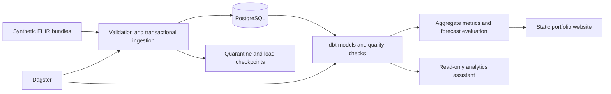

# Careflow

A synthetic healthcare data platform: FHIR ingestion, PostgreSQL, a dbt warehouse,
Dagster orchestration, a restricted analytics assistant, and statistical forecast
evaluation and a synthetic 90-day inpatient-risk experiment. A [separate React website](https://elitay152.github.io/careflow-dashboard/)
renders aggregate exports without database or model credentials.



## Run locally

Requires Python 3.11+, Docker, and Docker Compose:

```bash
bash scripts/bootstrap.sh
bash scripts/start_assistant.sh
```

Bootstrap installs dependencies, starts PostgreSQL, loads the extended fictional
demo, builds/tests the warehouse, and configures the reader. The assistant runs
on loopback port 8000 in free baseline mode. The demo has three patients and one
intentionally invalid record in quarantine. Existing configuration and data are
preserved. For an existing PostgreSQL database, export `DATABASE_URL` and use
`bash scripts/bootstrap.sh --existing-database`.

For a service-free SQLite example:

```bash
python -m venv .venv
.venv/bin/python -m pip install -c security-constraints.txt -e '.[dev]'
.venv/bin/careflow generate-demo
.venv/bin/careflow ingest data/demo
.venv/bin/careflow report
```

## Data pipeline

The loader persists Patient, Encounter, Condition, MedicationRequest, and
Organization resources, plus selected LOINC Observations (BMI, HbA1c, renal
measurements, and blood pressure). Encounter class, coded types/reasons, provider and location
references, patient death information, and provider geography are retained.
Medication references resolve within the same Bundle; provider aliases resolve
against the Organization catalog without network calls. Other resource types are
counted separately. This is a supported FHIR R4 subset, not full conformance.

Files load transactionally with SHA-256 checkpoints, upserts, provenance, and
quarantine reasons. Unchanged files are skipped. Files run serially; cross-file
parents must precede dependents. FHIR version ordering, deletions, and concurrent
loaders are not supported. Quarantine retains input payloads and source paths;
use synthetic data only.

With `.env` loaded:

```bash
.venv/bin/careflow ingest /path/to/synthetic/fhir
bash scripts/run_pipeline.sh
```

The pipeline builds 13 dbt models, runs 49 quality checks, and writes
`data/dashboard.html`. Default raw and analytics schemas are `public` and
`analytics`. Warehouse tables are rebuilt in full.

Existing PostgreSQL schemas receive nullable column additions when ingestion
connects. Replay the original bundles to populate new fields, then rebuild dbt:

```bash
.venv/bin/careflow ingest /path/to/synthetic/fhir --schema synthea_p1000_seed43 --reprocess
```

This preserves resource IDs and the usage ledger; unchanged inputs need explicit
`--reprocess`. Provider bundles may load before or after patient bundles because
facility matching happens during the warehouse build.


`bash scripts/start.sh` runs Dagster on loopback port 3000. Its daily schedule is
disabled by default; enabling it runs the job at 06:00 UTC while the daemon is
running. `CAREFLOW_INPUT_DIR` selects the input directory. Do not overlap direct
pipeline commands, scheduled loads, and website refreshes.

## Larger cohort and website

The portfolio cohort contains **1,194 synthetic patients, 321,670 clinical records, and 852 provider
organizations**, with zero quarantines in its validation run. See
[cohort generation and validation](docs/validation.md).

Careflow calculates distinct-patient KPIs, encounter-level duration statistics,
annual trends, and condition groups. Forecast evaluation compares statistical
models across three historical validation windows and a previously inspected
final-year development benchmark. Future predictions remain withheld pending
independent evaluation. [Metric definitions](docs/metrics.md) describe the denominators,
units, chronic subset, and evaluation protocol.

From the website checkout, with both repos available and PostgreSQL running:

```bash
npm run data:refresh -- --confirm-synthetic
```

This rebuilds/tests dbt, exports aggregates, syncs the snapshot, and builds the
website. Publishing uses the website's main-branch GitHub Pages workflow.
See [aggregate exports](docs/public-dashboard.md) for schema overrides and the
JSON contract.

## Assistant and cost controls

The assistant uses fixed parameterized SQL, a restricted reader, validated plans,
and metric citations. Baseline mode requires no API key. The optional OpenAI
planner is limited to `gpt-4.1-mini`, 256 output tokens, five attempts per UTC day,
and 25 lifetime attempts per workspace ledger. Failed attempts retain their
reservations; there are no automatic retries. Preserve `data/llm-usage.sqlite3`.

- [Assistant setup, questions, and API](docs/assistant.md)
- [Model credentials and spending controls](docs/api-costs.md)
- [GitHub Actions and Codespaces](docs/github.md)
- [Security boundaries](docs/security-audit.md)

## Checks

```bash
bash scripts/install.sh
.venv/bin/pytest -q
TEST_DATABASE_URL="$DATABASE_URL" .venv/bin/pytest -q
bash scripts/security_check.sh
```

PostgreSQL tests use temporary schemas and require schema-creation permission.
CI runs database tests, pipeline checks, dependency advisories, and secret scans.
Model calls run only through an explicitly invoked live workflow or live mode.

## Inpatient-risk experiment

The private audit creates adult quarterly snapshots, checks follow-up, merges
inpatient episodes, and separates patients and time across train/validation/test.
Diagnosis features require both onset and recorded dates before the snapshot;
current statuses are excluded. The fixed logistic model is compared with
training-prevalence and prior-admission baselines. No LLM or paid API is used.

With `.env` loaded and the enriched seed-43 schema available:

```bash
.venv/bin/careflow risk-audit --confirm-synthetic --raw-schema synthea_p1000_seed43 \
  --observation-end 2025-01-01 --output data/risk/synthea_p1000_seed43 --train
```

`--observation-end` attests the exclusive simulator cutoff; it is not inferred
from the last encounter. Omit `--train` for readiness only. Install `.[ml]` when
using a minimal installation; `scripts/install.sh` includes the pinned ML extra.
Patient snapshot files stay under ignored `data/risk/`; no individual scores,
serialized models, or snapshot files are exported publicly.

For a separate-seed check, generate and validate seed 44 in its own schema, then
repeat the audit with `--external-schema synthea_p1000_seed44`. This evaluates
the same fitted model and validation-selected thresholds without tuning them.
The refresh script includes matching aggregate risk evidence and withholds stale
or wrong-cohort artifacts. See [metric definitions](docs/metrics.md) for rules.

Selected Observations retain UCUM units, effective/issued timestamps, and source
provenance. Unsupported observation concepts remain ignored; invalid selected
quantities are quarantined. After replaying a cohort, run the local feature/model
comparison with `.venv/bin/python -m careflow.risk_experiment` as described in
[metric definitions](docs/metrics.md). It evaluates clinical measurements using
only results issued before each snapshot, with training-only imputation.
